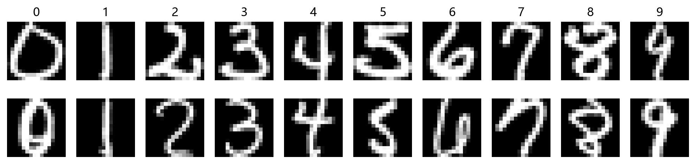
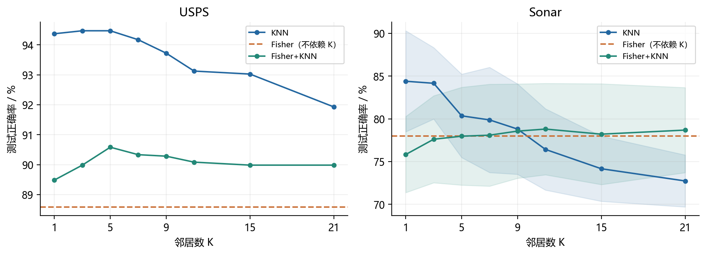
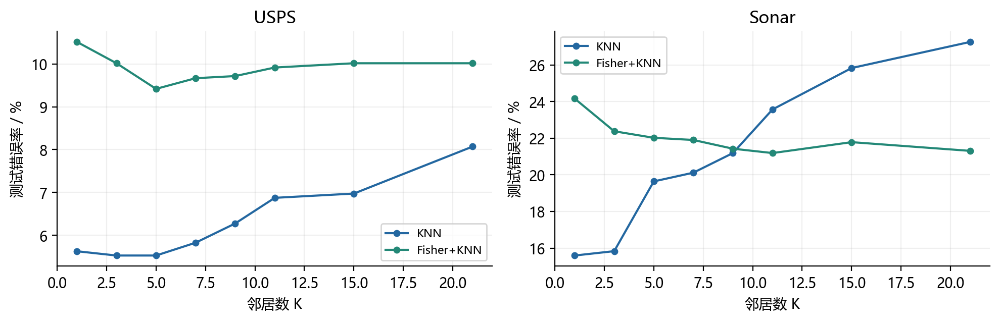
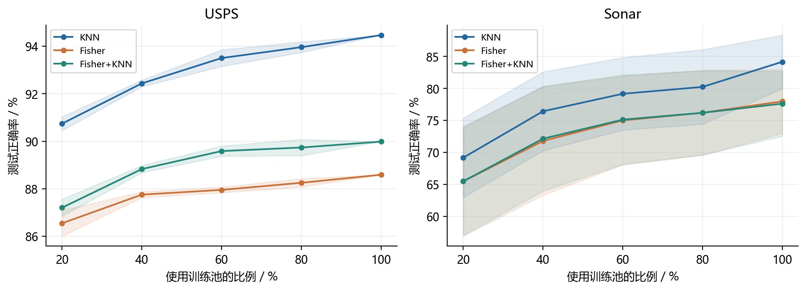
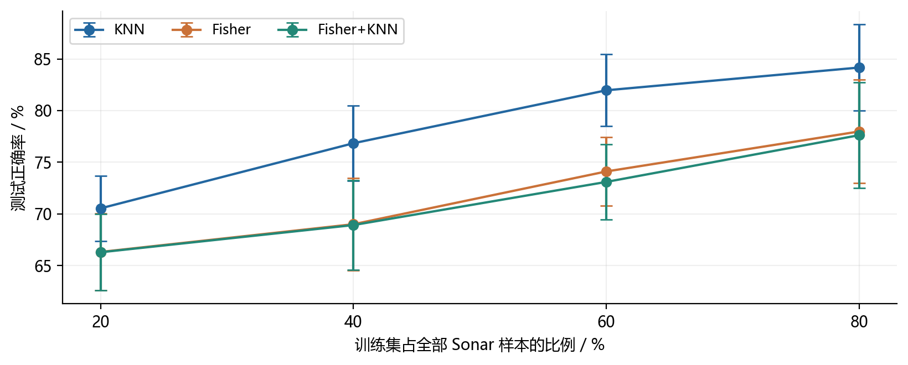
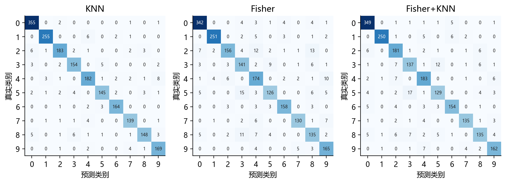
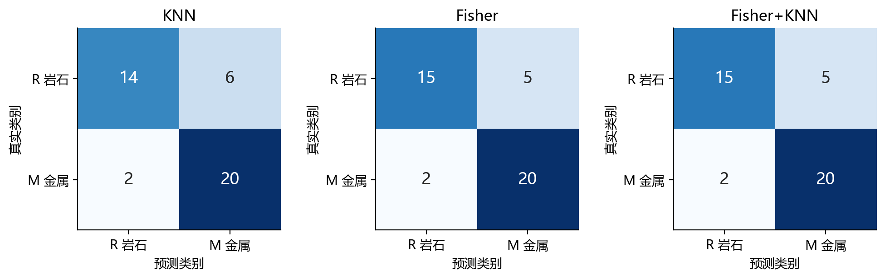
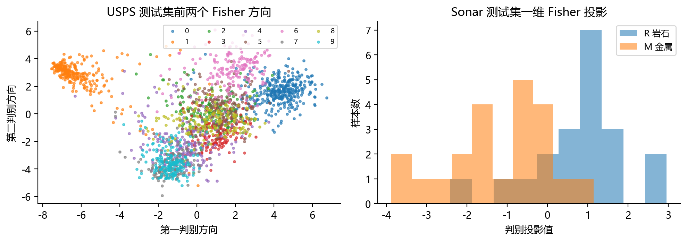
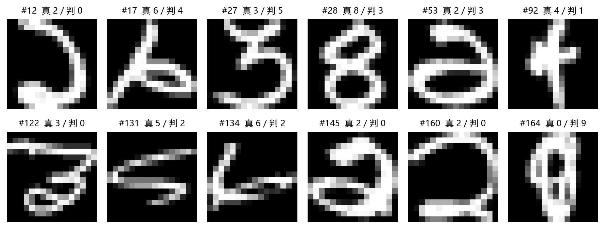

课程：模式识别    姓名：____________    学号：____________

班级：____________    实验日期：2026 年 10 月 11 日

# Fisher 判别与 K 近邻分类实验报告

## 摘要

本实验针对 USPS 十分类和 Sonar 二分类任务，从定义实现正则化 Fisher 线性判别投影与 K 近邻分类，比较原始特征 KNN、Fisher 投影后最近类中心分类、Fisher 投影后 KNN 三条流程。USPS 保留原始训练集与测试集；Sonar 采用分层随机留出并重复 20 次。主实验仅在训练集内部通过五折交叉验证选择 K 与正则化参数。

USPS 上，三种方法的测试正确率分别为 94.37%、88.59% 和 90.43%。Sonar 在 20 次独立随机种子划分下，正确率均值分别为 83.45%、78.93% 和 78.45%，对应标准差为 5.32、5.48 和 4.97 个百分点。总体上，原始特征 KNN 在本实验中取得更高的平均正确率；Fisher 显著减少特征维数，但判别投影也可能丢失局部分类信息。

K 值曲线显示，邻居数增大并不保证正确率提高；训练样本比例实验则显示，更多训练样本通常有利于提高识别率。报告同时给出错误率曲线、混淆矩阵、误分类样本及可复现的核心代码。所有数值均由随附程序实际运行产生。

关键词：模式识别；Fisher 线性判别；K 近邻；USPS；Sonar

## 1 实验目的

理解 Fisher 准则如何通过增大类间散布、抑制类内散布构造监督投影，并掌握 KNN 根据局部邻域投票进行分类的原理。分别考察 Fisher 的分类用途与其作为 KNN 前置降维方法的效果。

通过控制 K 值和训练样本规模，观察模型偏差、局部噪声和样本覆盖程度对泛化性能的影响；学习用分层划分、训练集内部调参和重复实验避免信息泄漏及偶然结论。

## 2 方法介绍

### 2.1 Fisher 线性判别分析

设训练集含 n 个 d 维样本，类别数为 C；第 c 类有 n_c 个样本，类均值为 μ_c，总均值为 μ。类内散布反映同类样本的离散程度，类间散布反映各类中心的分离程度。本实现统一除以 n；共同缩放不改变无正则化 Fisher 方向。

公式：S_W = (1/n) Σ_c Σ_(i∈c) (x_i−μ_c)(x_i−μ_c)^T

公式：S_B = (1/n) Σ_c n_c(μ_c−μ)(μ_c−μ)^T

二分类时，Fisher 寻找一条使投影后两类中心相距较远、同类样本较集中的方向。若类内矩阵可逆，最优方向与逆类内散布乘均值差成比例。

公式：J(w) = w^T S_B w / (w^T S_W w), w ∝ S_W^(-1)(μ_1−μ_2)

### 2.2 正则化与多分类扩展

当训练样本少于特征维数，或特征存在高度相关时，S_W 可能奇异或病态。因此加入与平均类内方差成比例的岭项。α 为无量纲超参数；代码对极小迹值增加数值保护。

公式：S_W,reg = S_W + α tr(S_W)/d I_d

多分类情形求解广义对称特征值问题，按特征值从大到小选取 q=min(d,C−1) 个方向构成 W。使用 scipy.linalg.eigh 求解，不显式计算矩阵逆；特征向量在正则化类内度量下归一化。

公式：S_B v = λ S_W,reg v; W^T S_W,reg W=I; z=W^T(x−μ)

USPS 最多保留 9 个判别方向，Sonar 最多保留 1 个。C−1 的限制源于类间散布矩阵的秩，而非任意指定的压缩比例。特征向量符号可整体翻转，但不影响欧氏距离和分类结果。

### 2.3 分类规则与 K 近邻

Fisher 本身定义的是投影准则，仍需指定分类规则。本报告中“Fisher”指投影空间内的最近类中心分类：计算各类投影均值，再把待测样本归入距离最近的类。采用等类先验；由于 W 在正则化类内度量下归一化，该规则对应等先验的正则化线性判别规则。Sonar 中等价于一维投影后以两个类中心的中点为阈值。

公式：Fisher 分类：ŷ = argmin_c ||z−z̄_c||²

KNN 计算待测样本与所有训练样本的欧氏距离，取距离最近的 K 个样本，以类别票数最多者作为预测。本文采用均匀投票，不使用距离加权。“Fisher+KNN”先由训练集估计 W，再在相同投影空间对训练样本和待测样本进行 KNN 分类。

公式：KNN 分类：ŷ = argmax_c Σ_(i∈N_K(x)) 1(y_i=c)

K 较小时，邻域局部性强，但对噪声和异常样本较敏感；K 较大时，投票更平滑，却可能跨越真实类别边界而增加偏差。奇数 K 只消除二分类中的同票情况，多分类仍可能同票。实现规定：票数相同取较小类别编码；距离相同保留训练样本原始顺序，以确保确定性。

### 2.4 实验流程步骤表

| 步骤 | 操作 | 防止信息泄漏的约束 |
| --- | --- | --- |
| 1 | 读取特征与标签并检查数据 | 不把标签拼入特征 |
| 2 | 确定外层训练集与测试集 | 相同划分供三种方法共同使用 |
| 3 | 在训练集内进行五折交叉验证 | 每折重新拟合标准化及 Fisher |
| 4 | 按验证正确率选择 K 和 α | 不使用测试标签选参数 |
| 5 | 使用全部外层训练样本重拟合 | 测试样本只执行变换与预测 |
| 6 | 统计指标并保存预测与划分索引 | 重复实验逐次保存真实结果 |

### 2.5 评价指标与计算开销

正确率 Accuracy 为预测正确样本数占测试样本总数的比例；错误率 Error=1−Accuracy。另报告 Macro-F1，即先分别计算每个类别的 F1，再对各类做等权平均，避免只依据整体正确率判断少数类别的表现。

公式：Accuracy=Σ_i 1(ŷ_i=y_i)/N; Macro-F1=Σ_c F1_c/C

KNN 的单次距离计算约为 O(nd)，本实现稳定全排序另需 O(n log n)，并分批查询控制内存。Fisher 拟合的主要开销为散布计算与特征分解，约为 O(nd²+d³)；投影后 KNN 的距离部分降为 O(nq)，但排序与投影仍有成本。

## 3 数据集介绍

### 3.1 USPS 手写数字

使用《The Elements of Statistical Learning》配套数据页公开的 ZIP code 数据 [1]。数字来源于邮件信封上的手写邮编，已做倾斜和尺寸归一化。每幅图像为 16×16 灰度图，展开后为 256 维向量；标签为 0 至 9。保留发布方提供的 7291 个训练样本和 2007 个测试样本，不混合后重新随机划分。

| 数字 | 0 | 1 | 2 | 3 | 4 | 5 | 6 | 7 | 8 | 9 |
| --- | --- | --- | --- | --- | --- | --- | --- | --- | --- | --- |
| 训练数 | 1194 | 1005 | 731 | 658 | 652 | 556 | 664 | 645 | 542 | 644 |
| 测试数 | 359 | 264 | 198 | 166 | 200 | 160 | 170 | 147 | 166 | 177 |



图 1 USPS 训练集示例 每类按原始顺序展示前两个样本

本地读取的像素值位于 [−1,1]，所有像素使用共同量纲，直接使用原始数值。若整体线性变换到 [0,1]，欧氏距离只改变公共比例，不改变 KNN 邻居次序。本实验不做逐像素 z-score，以免放大低方差背景像素。

### 3.2 UCI Sonar 声呐数据

使用 UCI 的 Connectionist Bench Sonar Mines vs Rocks 数据 [2]，共 208 个样本，每个样本包含 60 个频段能量特征，数值范围为 [0,1]。其中 R 表示岩石，共 97 个；M 表示金属圆柱目标，共 111 个。程序编码为 R=0、M=1。该数据集没有指定的统一训练测试文件，因此采用分层划分。

Sonar 不同特征的经验方差不同，采用训练集均值和标准差做 z-score；测试集仅复用这组统计量。交叉验证中，各折也必须单独计算统计量。数据维数与训练样本数接近时，Fisher 的协方差估计尤其需要正则化。

### 3.3 数据检查与任务边界

程序检查了文件形状、类别数量、有限数值和重复行。USPS 训练集、测试集内部以及二者之间均未发现完全相同的特征行；Sonar 也无完全重复特征行。没有缺失值填补、图像增强或特征筛选。USPS 与 MNIST、Fashion-MNIST 是不同数据集，本实验不使用后两者替代指定数据。

## 4 实验设置

### 4.1 主实验与参数选择

| 设置项 | USPS | Sonar |
| --- | --- | --- |
| 外层划分 | 原始训练 7291 / 测试 2007 | 分层训练 166 / 测试 42 |
| 主展示种子 | 交叉验证 42 | 划分与交叉验证均为 42 |
| 重复评价 | 原始测试集单次评价 | 种子 42 至 61 共 20 次 |
| 内部验证 | 训练集内分层五折 | 每次外层训练集内分层五折 |
| K 候选 | 1 3 5 7 9 11 15 21 | 1 3 5 7 9 11 15 21 |
| α 候选 | 0.001 0.01 0.1 | 0.001 0.01 0.1 |
| Fisher 维数 | 9 | 1 |
| 距离与投票 | 欧氏距离与均匀投票 | 欧氏距离与均匀投票 |

以五折验证正确率的算术平均值选参。KNN 只选择 K；Fisher 只选择 α；Fisher+KNN 联合选择 α 和 K。验证均值完全相同时优先较大 α，再取较小 K。选定参数后使用全部外层训练集重新拟合，再评价外层测试集。Sonar 每次重复都重新完成内部选参，不复用种子 42 的最佳参数。

### 4.2 K 值和训练比例的控制实验

K 值扫描统一固定 α=0.01，遍历上述 8 个 K，绘制测试正确率与错误率。曲线只用于描述敏感性，不根据曲线最高点回头修改主实验选参结果。Fisher 最近中心分类与 K 无关，正确率图用水平虚线表示。

固定测试集的学习曲线统一使用 K=3、α=0.01，避免把参数变化混入样本规模效应。训练池使用比例为 20%、40%、60%、80%、100%。每个类别单独随机排列后取前缀，因此同一种子的较小子集包含于较大子集。USPS 重复 5 次，种子为 0 至 4；Sonar 在 20 次外层划分上分别生成嵌套子集。未使用的训练池样本不加入测试集。

另对 Sonar 改变整个数据集的训练/测试比例，分别为 20/80、40/60、60/40、80/20，每个比例重复 20 次，仍固定 K=3、α=0.01。该实验直接满足训练测试比例分析要求；因测试集会随比例改变，其曲线不能解释为在同一测试集上增加数据的纯效果。

### 4.3 环境与统计口径

运行环境为 Windows 11、Python 3.13.5、NumPy 2.1.3、SciPy 1.15.3、scikit-learn 1.6.1、Matplotlib 3.9.2。使用 CPU，数值计算线程上限为 2，不需要 GPU。完整实验计算用时约 57.3 秒，不含制图与报告生成。

均值 ± 标准差中的标准差采用 ddof=1，单位为百分点；阴影或误差棒表示一次标准差，并非 95% 置信区间。重复留出之间样本可能重叠，不把 20 次评价视作互不相关的 20 个新数据集，也不据此宣称统计显著性。

## 5 实验结果

### 5.1 训练集内部选参结果

| 数据集 | 方法 | K | α | 验证正确率 % |
| --- | --- | --- | --- | --- |
| USPS | KNN | 1 | 不适用 | 97.02 |
| USPS | Fisher | 不适用 | 0.01 | 92.20 |
| USPS | Fisher+KNN | 3 | 0.1 | 94.45 |
| Sonar | KNN | 3 | 不适用 | 80.71 |
| Sonar | Fisher | 不适用 | 0.1 | 78.34 |
| Sonar | Fisher+KNN | 15 | 0.1 | 78.95 |

Sonar 表中为种子 42 的参数，仅对应后续单次混淆矩阵与示例。20 次重复实验的 K 和 α 可能不同，逐次参数保存在 sonar_repeated.csv 中。

### 5.2 独立测试结果

| 数据集 | 方法 | 正确率 % | 错误率 % | Macro-F1 |
| --- | --- | --- | --- | --- |
| USPS | KNN | 94.37 | 5.63 | 0.9392 |
| USPS | Fisher | 88.59 | 11.41 | 0.8763 |
| USPS | Fisher+KNN | 90.43 | 9.57 | 0.8951 |
| Sonar | KNN | 80.95 | 19.05 | 0.8056 |
| Sonar | Fisher | 83.33 | 16.67 | 0.8309 |
| Sonar | Fisher+KNN | 83.33 | 16.67 | 0.8309 |

USPS 的 KNN 在 2007 个测试样本中正确识别 1894 个，错误 113 个。Fisher+KNN 比 Fisher 最近中心分类提高 1.84 个百分点，但比原始特征 KNN 低 3.94 个百分点。Sonar 种子 42 下，Fisher 和 Fisher+KNN 均正确 35/42，KNN 为 34/42，差异仅对应一个测试样本。

### 5.3 Sonar 重复划分结果

| 方法 | 正确率均值 ± 标准差 % | Macro-F1 均值 |
| --- | --- | --- |
| KNN | 83.45 ± 5.32 | 0.8325 |
| Fisher | 78.93 ± 5.48 | 0.7883 |
| Fisher+KNN | 78.45 ± 4.97 | 0.7827 |

重复实验后，KNN 的平均正确率高于两个 Fisher 流程。种子 42 的单次排序并不能代表总体重复结果，因此后续结论以完整重复实验为依据，不挑选最好的一次划分。

### 5.4 K 值对正确率与错误率的影响



图 2 K 值与测试正确率 α 固定为 0.01 Sonar 为 20 次均值及标准差



图 3 K 值与测试错误率 Error 等于 1 减 Accuracy

USPS 原始特征 KNN 在 K=3、5 时的描述性测试正确率均为 94.47%，K=21 时降至 91.93%。但主实验仍报告内部交叉验证选出的 K=1 及其 94.37% 测试正确率，不能在看过测试结果后把主结果改为 94.47%。

Sonar 原始特征 KNN 从 K=1 的 84.40% 逐渐降至 K=21 的 72.74%；Fisher+KNN 则由 75.83% 提升后在约 78% 附近波动。解释是原始空间可能需要更局部的邻域，而一维投影存在类别重叠，小 K 更易受局部噪声影响。该解释与观察一致，但不是对数据生成机制的证明。

图中 Fisher 的水平虚线表示其分类规则不依赖 K。固定 α 的敏感性实验与主实验联合调参设置不同，不能将两者的数值差异误认为重复运行不一致。

### 5.5 固定测试集下的训练样本比例



图 4 训练池使用比例与正确率 固定 K 为 3 和 α 为 0.01

| 数据集 | 训练池比例 | 训练数 | KNN % | Fisher % | Fisher+KNN % |
| --- | --- | --- | --- | --- | --- |
| USPS | 20% | 1454 | 90.74 ± 0.29 | 86.55 ± 0.54 | 87.20 ± 0.36 |
| USPS | 40% | 2912 | 92.44 ± 0.14 | 87.75 ± 0.12 | 88.83 ± 0.15 |
| USPS | 60% | 4371 | 93.50 ± 0.35 | 87.95 ± 0.12 | 89.59 ± 0.21 |
| USPS | 80% | 5829 | 93.96 ± 0.22 | 88.25 ± 0.18 | 89.74 ± 0.34 |
| USPS | 100% | 7291 | 94.47 ± 0.00 | 88.59 ± 0.00 | 89.99 ± 0.00 |
| Sonar | 20% | 32 | 69.17 ± 6.20 | 65.48 ± 8.58 | 65.48 ± 8.44 |
| Sonar | 40% | 65 | 76.43 ± 6.18 | 71.79 ± 8.47 | 72.14 ± 8.22 |
| Sonar | 60% | 99 | 79.17 ± 5.67 | 75.00 ± 6.97 | 75.12 ± 6.97 |
| Sonar | 80% | 132 | 80.24 ± 5.84 | 76.19 ± 6.65 | 76.19 ± 6.60 |
| Sonar | 100% | 166 | 84.17 ± 4.18 | 77.98 ± 5.00 | 77.62 ± 5.09 |

USPS 测试数始终为 2007；Sonar 每个外层划分的测试数始终为 42。分层取整使实际训练数略低于理论比例：例如 Sonar 的 20% 训练池使用 32 个样本，而不是 208×20%。

USPS 的 KNN 从 90.74% 提升至 94.47%，Fisher 从 86.55% 提升至 88.59%；Sonar 的 KNN 从 69.17% 提升至 84.17%。增加数据提高了局部样本覆盖，也改善了 Fisher 对均值和类内散布的估计。

USPS 在 100% 训练池时所有种子使用完全相同的数据，确定性模型的结果也相同，因此标准差为零；这不表示模型对其他数据集没有不确定性。

### 5.6 改变训练集与测试集比例



图 5 Sonar 不同训练测试比例下的正确率 误差棒为一次标准差

| 训练测试比例 % | 实际训练测试数 | KNN % | Fisher % | Fisher+KNN % |
| --- | --- | --- | --- | --- |
| 20 / 80 | 41 / 167 | 70.54 ± 3.16 | 66.32 ± 3.70 | 66.29 ± 3.71 |
| 40 / 60 | 83 / 125 | 76.84 ± 3.63 | 69.00 ± 4.46 | 68.92 ± 4.35 |
| 60 / 40 | 124 / 84 | 81.96 ± 3.48 | 74.11 ± 3.34 | 73.10 ± 3.65 |
| 80 / 20 | 166 / 42 | 84.17 ± 4.18 | 77.98 ± 5.00 | 77.62 ± 5.09 |

当训练比例从 20% 增至 80%，KNN 的正确率均值从 70.54% 增至 84.17%，提升 13.63 个百分点；Fisher 从 66.32% 增至 77.98%，Fisher+KNN 从 66.29% 增至 77.62%。三条曲线总体上升，但并不意味着任何一次随机划分都严格单调。

小训练比例下，Sonar 只有 41 个训练样本，却有 60 个特征。此时类内散布秩受训练数限制，直接求逆不可行；岭正则化使问题可解，但不能替代缺失的训练信息。正则化只能缓和不稳定性，并不能保证高正确率。

训练比例提高时，测试样本数也从 167 减少到 42，单个预测错误对正确率的影响从约 0.60 个百分点增至约 2.38 个百分点。因此测试比例过小会降低估计分辨率；本实验同时给出固定测试集学习曲线，以帮助区分训练信息增多和测试集变化两种因素。

### 5.7 计算与存储的观察

| 方法 | 特征维数 | 拟合耗时 s | 整批预测耗时 s |
| --- | --- | --- | --- |
| KNN | 256 | 0.0000 | 1.8960 |
| Fisher | 9 | 0.0561 | 0.0034 |
| Fisher+KNN | 9 | 0.0540 | 0.7203 |

耗时来自同一次主实验，未做严格重复计时基准。拟合计时从完成输入预处理后开始；Fisher+KNN 的训练与测试投影计入拟合段，KNN 拟合仅对应准备引用，其接近零不包含统一预处理与数据复制成本。预测段表示后续分类计算，不能据此声称精确的端到端加速倍数。维数由 256 降至 9 明确减少了距离计算中的特征量，但仍存在排序开销。

### 5.8 混淆矩阵与类别错误



图 6 USPS 独立测试集混淆矩阵 行是真实标签 列是预测标签

USPS 的 KNN 对数字 0 的召回率为 355/359=98.89%，对数字 8 为 148/166=89.16%。常见错误包括 4→9 共 8 个、1→4 共 6 个、2→0 共 6 个、8→3 共 6 个。错误并非均匀分布，容易混淆的笔画和局部形态值得进一步分析。



图 7 Sonar 种子 42 的测试混淆矩阵 R 表示岩石 M 表示金属目标

该 Sonar 测试集含 20 个 R 和 22 个 M。KNN 把 6 个 R 误判为 M、2 个 M 误判为 R；两个 Fisher 流程分别为 5 个和 2 个。两个 Fisher 方法在这次测试上拥有相同的混淆矩阵，不表示其分类规则相同，也不保证在其他划分中给出相同结果。

### 5.9 判别投影与误分类样本



图 8 测试样本的 Fisher 投影 投影矩阵只由训练集估计

USPS 左图只展示前两个判别方向，实际分类使用 9 维，不能仅凭二维散点判断九维可分性。Sonar 只能保留一个判别方向，测试样本的两类分布仍有重叠。Fisher 强调类均值间的分离，未必保留原始空间所有有利于局部邻居识别的结构。



图 9 USPS 主实验 KNN 按测试集原始顺序排列的前 12 个误分类样本

图中编号为零起始的测试样本索引，“真”是真实类别，“判”是模型预测。采用固定顺序展示错误，避免只选择看起来容易解释的例子。部分数字有倾斜、断笔或形状接近其他类别的现象，像素欧氏距离并不自动具有平移或形变不变性。

## 6 实验分析

### 6.1 为什么 Fisher 降维没有提升全部任务的正确率

Fisher 优化的是全局类间与类内散布之比，不是直接最小化 KNN 的分类错误率。USPS 中同一数字可能包含不同书写风格，一个类均值难以代表所有子群；投影到 9 维会保留主要线性判别方向，却也可能压缩某些对局部距离有用的笔画差异。因此，Fisher+KNN 虽然优于线性最近中心规则，仍弱于原始像素 KNN。

Sonar 的 60 维特征最终被压缩为 1 维，这是二分类 Fisher 的结构性限制。若区分类别的信息不能由单一线性方向完整表达，则降维后的 KNN 也无法恢复被舍弃的信息。20 次重复结果支持在当前预处理、参数网格与划分协议下保留原始特征 KNN，但不能推出 Fisher 在所有声呐数据上都更差。

### 6.2 K 值选择与训练规模的联系

K 是邻域规模，适合的取值取决于样本密度、噪声水平和特征表示。原始 Sonar 特征上的大 K 可能跨过局部类别边界，导致均值正确率下降；Fisher 一维投影上的适度平滑则可能减少单点扰动。不能因为某个数据集的 K=1 较好，就把 K=1 固定为所有任务的最佳值。

增加训练样本对 KNN 和 Fisher 都有帮助，但原因不同：KNN 获得更充分的邻域覆盖，Fisher 获得更稳定的均值及散布估计。USPS 上从训练池 20% 到 40% 时 KNN 增益约 1.69 个百分点，从 80% 到 100% 时约 0.51 个百分点，体现出边际收益减小的趋势。

### 6.3 实验可信度和局限

主实验的测试标签未参与标准化、Fisher 拟合或参数选择；三种方法共用相同外层划分。学习曲线使用固定参数和嵌套训练子集，使比较口径一致。手写 KNN 与 scikit-learn 的参考实现通过预测一致性校验，Fisher 最近中心规则与全空间等先验正则化 LDA 公式也通过一致性校验。

结果仍有边界：USPS 只用一个固定测试集，不能估计更换测试集后的方差；Sonar 的重复留出存在样本重叠，误差条不应被当作独立重复的置信区间。该数据采集涉及多种观察角度，现有文件没有足够的分组标识用于按实体或采集批次隔离，因此随机样本级划分的成绩不能直接代表全新目标或采集条件下的部署性能。

参数网格有限，未测试图像对齐、核 Fisher、加权 KNN 或其他特征学习方法；固定 α 的曲线与调参后的主实验回答的是不同问题。后续可在新的验证协议下扩展方法，但不能反复利用本次测试结果调优后仍把它视为未见测试集。

### 6.4 结论

本实验完成了两个指定数据集上的 Fisher 与 KNN 实现、K 值敏感性分析及训练比例实验。原始特征 KNN 在 USPS 独立测试和 Sonar 重复评价中表现更好；Fisher 的主要收益是压缩表示与简化分类计算，代价可能是局部结构损失。选择方法应结合正确率、样本规模及计算成本，并以训练集内部验证和一致的测试协议为依据。

### 6.5 复现说明与结果文件

在项目根目录执行 run_experiments.ps1，或依次运行下面的命令。数据文件已随项目保存，下载脚本首先检查文件和 SHA256；文件存在且一致时无需联网。重新实验会更新 results 与 figures，若需要同步更新 Word 报告，还需运行 build_report.py。

```text
python src/download_data.py
python src/verify_models.py
python src/experiment.py
python src/make_figures.py
python src/audit_results.py
python src/build_report.py
```

运行环境需具备 requirements.txt 列出的依赖。实验脚本默认执行 Sonar 20 次、USPS 学习曲线 5 次；报告生成使用已保存结果，不会自行重新训练。报告内容按默认完整实验编排，更改实验协议后应同步修改分析文字。

| 文件 | 用途 |
| --- | --- |
| main_results.csv 与 details.json | 主实验指标、所选参数及混淆矩阵 |
| cv_results.csv | USPS 和 Sonar 种子 42 的全部候选参数验证分数 |
| sonar_repeated.csv 与 sonar_summary.csv | 20 次重新调参的逐次结果及汇总 |
| k_sweep 与 learning 与 ratio 系列 CSV | K 扫描、固定测试学习曲线、训练测试比例实验 |
| split_indices.npz 与 predictions 文件 | 划分索引及主实验逐样本预测 |
| settings.json 与 audit.json | 版本、种子、数据哈希及完整性检查 |

## 参考文献

[1] Hastie T, Tibshirani R, Friedman J. The Elements of Statistical Learning 配套 ZIP code 数据及说明. https://hastie.su.domains/ElemStatLearn/data.html ; https://hastie.su.domains/ElemStatLearn/datasets/zip.info.txt

[2] Sejnowski T, Gorman R. Connectionist Bench Sonar Mines vs Rocks [Dataset]. UCI Machine Learning Repository, 1988. DOI: 10.24432/C5T01Q. https://archive.ics.uci.edu/dataset/151/connectionist+bench+sonar+mines+vs+rocks

[3] scikit-learn. Linear and Quadratic Discriminant Analysis. https://scikit-learn.org/stable/modules/lda_qda.html

[4] scikit-learn. Nearest Neighbors. https://scikit-learn.org/stable/modules/neighbors.html

数据及在线说明访问日期为 2026 年 10 月 11 日。方法说明参照 [3][4]；算法核心为随附 NumPy 与 SciPy 实现，scikit-learn 用于划分、指标和独立校验。

## 7 附录 核心代码

### 7.1 Fisher 投影与分类

以下为 src/models.py 的实际运行代码节选。X 的每一行是一个样本；实现采用行向量形式，因此 transform 写为 (X−mean) @ W。

```python
import numpy as np
from scipy.linalg import eigh
from scipy.spatial.distance import cdist

class Fisher:
    """Regularized Fisher projection; nearest centroid uses equal class priors.

    W is normalized in the regularized within-class covariance metric.
    Consequently Euclidean distance in the projected space has a defined scale.
    """
    def __init__(self, alpha=0.01):
        self.alpha = alpha

    def fit(self, X, y):
        X = np.asarray(X, dtype=float)
        self.classes_ = np.unique(y)
        n, d = X.shape
        self.mean_ = X.mean(axis=0)
        self.means_ = np.array([X[y == c].mean(axis=0)
                                for c in self.classes_])
        Sw = np.zeros((d, d))
        Sb = np.zeros((d, d))
        for c, mu in zip(self.classes_, self.means_):
            Xc = X[y == c] - mu
            Sw += Xc.T @ Xc / n
            delta = mu - self.mean_
            Sb += len(Xc) * np.outer(delta, delta) / n
        scale = np.trace(Sw) / d
        self.within_ = Sw + self.alpha * max(scale, 1e-12) * np.eye(d)
        dim = min(d, len(self.classes_) - 1)
        eigenvalues, vectors = eigh(Sb, self.within_,
                                    subset_by_index=[d - dim, d - 1])
        self.W_ = vectors[:, ::-1]
        self.eigenvalues_ = eigenvalues[::-1]
        self.centroids_ = self.transform(self.means_)
        return self

    def transform(self, X):
        return (X - self.mean_) @ self.W_

    def predict(self, X):
        distances = cdist(self.transform(X), self.centroids_, 'sqeuclidean')
        return self.classes_[distances.argmin(axis=1)]
```

### 7.2 KNN 多参数预测与预处理

多组 K 共享同一批距离排序，以避免重复计算。此处仍为精确近邻，没有使用近似检索。批大小仅影响内存与速度，不改变预测规则。

```python
def knn_predict_many(X_train, y_train, X_query, ks, batch_size=128):
    """One exact distance search for all K values; deterministic tie rules.

    Equal distances retain training-row order. Equal vote counts choose the
    smallest class label. Stable full sorting avoids argpartition boundary ties.
    """
    ks = sorted(set(int(k) for k in ks))
    if not ks or ks[0] < 1 or ks[-1] > len(y_train):
        raise ValueError('K must be between 1 and the training sample count')
    classes, encoded = np.unique(y_train, return_inverse=True)
    predictions = {k: [] for k in ks}
    for start in range(0, len(X_query), batch_size):
        distances = cdist(X_query[start:start + batch_size], X_train,
                          'sqeuclidean')
        indices = np.argsort(distances, axis=1, kind='stable')[:, :ks[-1]]
        neighbor_labels = encoded[indices]
        counts = np.zeros((len(indices), len(classes)), dtype=int)
        for j in range(ks[-1]):
            counts[np.arange(len(indices)), neighbor_labels[:, j]] += 1
            if j + 1 in predictions:
                predictions[j + 1].append(classes[counts.argmax(axis=1)])
    return {k: np.concatenate(v) for k, v in predictions.items()}


def preprocess(X_train, X_query, dataset):
    """USPS pixels already have a common scale; Sonar uses training-only z-score."""
    if dataset == 'USPS':
        return X_train.copy(), X_query.copy()
    mu = X_train.mean(axis=0)
    sigma = X_train.std(axis=0)
    sigma[sigma < 1e-12] = 1.0
    return (X_train - mu) / sigma, (X_query - mu) / sigma
```

### 7.3 训练集内部五折参数选择

以下节选自 src/experiment.py。KS=[1,3,5,7,9,11,15,21]，ALPHAS=[0.001,0.01,0.1]；METHODS 为 KNN、Fisher、Fisher+KNN。函数只接收外层训练集，因此无法访问外层测试标签。

```python
def select_parameters(X, y, dataset, seed=42, folds=5):
    """Each fold refits preprocessing and Fisher using only its training part."""
    cv = StratifiedKFold(folds, shuffle=True, random_state=seed)
    scores = {(m, a, k): [] for m in METHODS
              for a in ([0.0] if m == 'KNN' else ALPHAS)
              for k in ([0] if m == 'Fisher' else KS)}
    for train_idx, val_idx in cv.split(X, y):
        Xt, Xv = preprocess(X[train_idx], X[val_idx], dataset)
        yt, yv = y[train_idx], y[val_idx]
        for k, pred in knn_predict_many(Xt, yt, Xv, KS).items():
            scores['KNN', 0.0, k].append(accuracy_score(yv, pred))
        for alpha in ALPHAS:
            fisher = Fisher(alpha).fit(Xt, yt)
            scores['Fisher', alpha, 0].append(accuracy_score(yv, fisher.predict(Xv)))
            for k, pred in knn_predict_many(fisher.transform(Xt), yt,
                                           fisher.transform(Xv), KS).items():
                scores['Fisher+KNN', alpha, k].append(accuracy_score(yv, pred))
    rows = [dict(dataset=dataset, method=m, alpha=a, k=k,
                 cv_mean=float(np.mean(values)), cv_std=float(np.std(values, ddof=1)))
            for (m, a, k), values in scores.items()]
    selected = {}
    for method in METHODS:
        # Equal mean: prefer stronger regularization, then smaller K.
        best = sorted([r for r in rows if r['method'] == method],
                      key=lambda r: (-r['cv_mean'], -r['alpha'], r['k']))[0]
        selected[method] = dict(alpha=best['alpha'], k=best['k'], cv_mean=best['cv_mean'])
    return selected, rows
```

验证折中的预处理参数与 Fisher 投影均重新从该折训练部分估计。完整的外层循环、数据读取、指标计算和结果导出见同目录完整源文件。

### 7.4 固定参数评价与嵌套训练子集

```python
def evaluate(Xt, yt, Xe, ye, dataset, params, all_k=False):
    Xt, Xe = preprocess(Xt, Xe, dataset)
    predictions, models, result = {}, {}, []
    for method in METHODS:
        start = time.perf_counter()
        par = params[method]
        if method == 'KNN':
            Zt, Ze = Xt, Xe
            model = None
        else:
            model = Fisher(par['alpha']).fit(Xt, yt)
            Zt, Ze = model.transform(Xt), model.transform(Xe)
        fit_s = time.perf_counter() - start
        start = time.perf_counter()
        if method == 'Fisher':
            pred_map = {0: model.predict(Xe)}
        else:
            pred_map = knn_predict_many(Zt, yt, Ze, KS if all_k else [par['k']])
        predict_s = time.perf_counter() - start
        for k, pred in pred_map.items():
            result.append(dict(dataset=dataset, method=method, k=k, alpha=par['alpha'],
                               n_train=len(yt), n_test=len(ye),
                               accuracy=float(accuracy_score(ye, pred)),
                               error=float(1 - accuracy_score(ye, pred)),
                               macro_f1=float(f1_score(ye, pred, average='macro')),
                               fit_seconds=fit_s, predict_seconds=predict_s))
        predictions[method] = pred_map[par['k']]
        models[method] = model
    return result, predictions, models


def nested_subset(y, fraction, seed):
    """Per-class shuffled prefixes: larger fractions contain smaller subsets."""
    rng = np.random.default_rng(seed)
    selected = []
    for c in np.unique(y):
        indices = rng.permutation(np.flatnonzero(y == c))
        selected.extend(indices[:max(1, int(np.floor(fraction * len(indices))))])
    return np.sort(selected)
```
